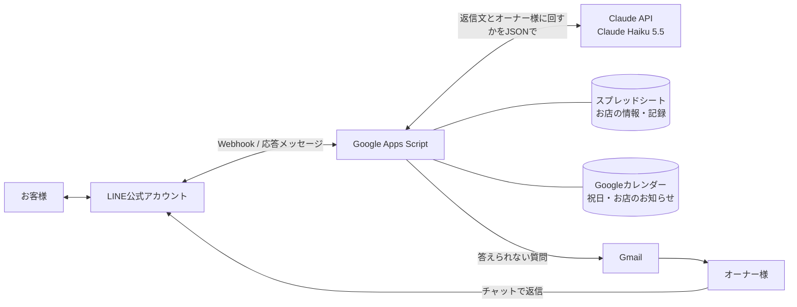

# 美容院 LINE AI自動応答

美容院の LINE 公式アカウントに届いたお客様の質問に、AI（Claude）が自動で答えるしくみです。AI が答えられない質問は、オーナー様にメールで知らせます。

> 案件の練習として作ったもので、お店は架空です。ヒアリング → 要件定義 → 技術選定 → 提案書 → 実装 → テスト → マニュアル、の流れで進めました。

## できること

- **AI の自動応答**：営業時間・メニューと料金・駐車場・予約の方法などに、お店の情報をもとに答える。書いていないことは推測で答えない
- **答えられない質問をオーナー様に回す**：日時を指定した予約、キャンセル、体の相談、苦情などは「担当者から返信します」と返し、オーナー様にメールで知らせる
- **オーナー様が対応中は AI が黙る**：回したお客様には 24 時間 AI が返信しない。メールのリンクから早めに戻すこともできる
- **祝日と臨時休業**：Google カレンダーから国の祝日と「お店のお知らせ」（臨時休業・営業時間の変更）を読み、「今日はやっていますか？」に正しく答える。オーナー様はスマホのカレンダーアプリに予定を入れるだけ
- **お店の情報はスプレッドシートで更新**：メニューや料金を直すと、次の質問からすぐ反映される
- **止まったときに気づく**：エラーを開発者にメールで知らせる。毎朝 LINE・AI・スプレッドシート・カレンダーが使えるかを自動で確かめる
- **個人情報への配慮**：AI に送る前に電話番号・メールアドレスを「＊＊＊」に置き換える。名前と LINE の ID は AI に送らない。質問の記録は 6 か月で自動で消す

## しくみ



| 役割 | 使ったもの | 理由 |
|---|---|---|
| LINE との接続 | LINE Messaging API | 応答メッセージは通数に数えないので無料 |
| 動かす場所 | Google Apps Script | 無料。スプレッドシート・Gmail・カレンダーをそのまま使える |
| AI | Claude Haiku 5.5 | 1 日 10〜15 件の問い合わせで月 60 円ほど |
| お店の情報・記録 | Google スプレッドシート | オーナー様が自分で更新できる |
| 通知 | Gmail | 無料で、LINE の通数を使わない |

月の費用は、LINE の無料プランで約 100 円（AI の利用料など）を見込んでいます。くわしくは [tech-selection.md](tech-selection.md) を参照してください。

## 工夫したところ

- **答えるか回すかを AI に JSON で決めさせる**：構造化出力（JSON Schema）で `reply`（返信文）・`escalate`（オーナー様に回すか）・`reason`（理由）を受け取る
- **日付の取り違えを防ぐ**：「今日」「明日」「来週の土曜日」を AI が間違えないよう、今日から 2 週間の日付・曜日・祝日・お知らせを 1 日 1 行で渡す。祝日は 3 か月先まで渡し、AI の知識では答えさせない
- **プロンプトの指示をテストで調整**：23 問のテスト（`runTestQuestions`）で、答えるべき質問と回すべき質問を確かめ、×が 0 になるまで指示を直した
- **プロンプトインジェクション対策**：「設定を無視して」などの依頼には従わないよう指示している
- **コストを抑える**：お店の情報を含む指示はプロンプトキャッシュに載せる
- **GAS の制限への対応**：GAS では LINE の署名ヘッダーを読めないので、Webhook URL の秘密の文字列と `destination` で本物かを確かめる

## ファイル構成

```
src/
  Main.js      LINE からの Webhook の入口（置き換え → AI → 返信 → 記録 → 通知）
  Ai.js        Claude API の呼び出し、指示文、お店の情報の読み込み、直前の会話
  Calendar.js  祝日とお店のお知らせのカレンダー
  Pause.js     オーナー様が対応中のお客様に AI を止める、メールのリンクで再開
  Notify.js    オーナー様へのメール
  Monitor.js   エラーのメール、毎朝のチェック、古い記録の削除
  Privacy.js   電話番号・メールアドレスの置き換え
  Line.js      LINE Messaging API
  Config.js    設定値（スクリプト プロパティ）の読み出し
  Setup.js     初回に実行する関数
  Test.js      AI の答え方をまとめて確かめるテスト
tests/
  privacy.test.js  置き換えのテスト（Node.js で実行）
```

## 動かし方

1. [clasp](https://github.com/google/clasp) をインストールしてログインし、Apps Script のプロジェクトを作る。`.clasp.json.example` を `.clasp.json` に写して、スクリプト ID を入れる
2. `clasp push` でコードを送り、ウェブアプリとしてデプロイする
3. GAS のエディタで、`src/Setup.js` の先頭に書いた順に初回の関数を実行する（Webhook の秘密の文字列、LINE のトークン、スプレッドシート、カレンダー、毎朝のトリガー）
4. スクリプト プロパティに `ANTHROPIC_API_KEY` などを登録する（一覧は `src/Config.js`）
5. LINE Developers で Webhook URL（`.../exec?key=<WEBHOOK_KEY>`）を登録し、「Webhook の再送」はオフにする

秘密の値（API キー、トークンなど）はコードに書かず、スクリプト プロパティに保存しています。

## テスト

```
node --test "tests/*.test.js"
```

AI の答え方のテストは、GAS のエディタで `runTestQuestions` を実行します（結果は記録のスプレッドシートの「テスト結果」タブに出ます）。

## 資料

- [requirements.md](requirements.md)：ヒアリングと要件定義
- [tech-selection.md](tech-selection.md)：技術選定と実装の方針
- `LINE AI自動応答 ご提案書.pdf`、`別紙_詳しい資料.pdf`：オーナー様向けの提案書
